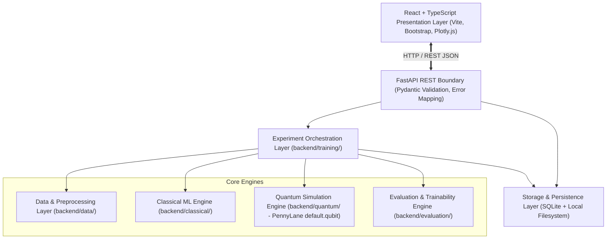
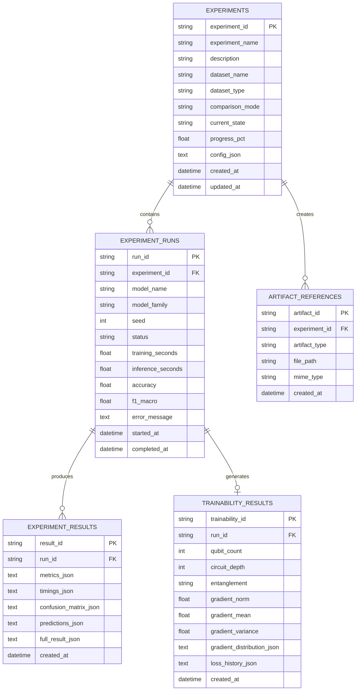

# System Architecture & Technical Design — QML Benchmark Studio

> **Status:** Formal Specification — Day 3, 2026-11-19  
> **Project:** 6th-Semester Research Project  
> **Repository:** https://github.com/BHARATHKUMAR-max/QUANTUM_SIMMULATOR  
> **Companion Documents:** [MVP Scope](MVP_SCOPE.md) · [Development Backlog](DEVELOPMENT_BACKLOG.md) · [Data Flow](DATA_FLOW.md)

---

## Table of Contents

1. [System Overview](#1-system-overview)
2. [Layered Architecture](#2-layered-architecture)
3. [Module Responsibilities](#3-module-responsibilities)
4. [Common Result Schema Design](#4-common-result-schema-design)
5. [Experiment Configuration Schema Design](#5-experiment-configuration-schema-design)
6. [SQLite Storage Model](#6-sqlite-storage-model)
7. [Frontend-Backend Communication](#7-frontend-backend-communication)
8. [Engineering Architecture Rules](#8-engineering-architecture-rules)

---

## 1. System Overview

**QML Benchmark Studio** is a scientific experimentation workbench engineered to benchmark Quantum Machine Learning (QML) models against Classical Machine Learning baselines on equal algorithmic footing.

The architecture emphasizes **experimental fairness**, **isolation from data leakage**, **strict simulation boundary documentation**, and **reproducibility**.



---

## 2. Layered Architecture

The system is organized into eight decoupled layers. Each layer adheres to strict inward dependency constraints to facilitate both unit-level mocking and comprehensive integration testing.

| Layer | Component | Core Responsibility |
|---|---|---|
| **1. Presentation Layer** | React, TypeScript, Vite, Bootstrap, Framer Motion, Plotly.js | Interactive dashboard for dataset inspection, pipeline configuration, real-time polling, and chart visualization. |
| **2. API Routing Layer** | FastAPI, Uvicorn, Pydantic | Validates incoming payloads, exposes REST contracts, manages HTTP errors, and handles file uploads. Contains **zero ML logic**. |
| **3. Orchestration Layer** | `backend/training/` | Coordinates the full experimental lifecycle: seed sequencing, step execution, cancellation checking, progress tracking, and aggregation. |
| **4. Data & Preprocessing Layer** | `backend/data/` | Manages dataset acquisition, CSV validation diagnostics, stratified partitioning, leakage-free scaling/imputation, and feature reduction. |
| **5. Classical ML Engine** | `backend/classical/` | Wraps scikit-learn models (`DummyClassifier`, `SVM`, `MLP`, `RandomForest`) under a uniform interface. |
| **6. Quantum ML Engine** | `backend/quantum/` | PennyLane circuit generation (`default.qubit`), angle/ZZ feature maps, VQC ansatzes (RX/RY/RZ rotations, linear/circular entanglement), and fidelity quantum kernels. |
| **7. Evaluation & Trainability Layer** | `backend/evaluation/` | Computes standardized classification metrics, timing profiles, confusion matrices, and parameter-shift gradient statistics for barren plateau analysis. |
| **8. Storage & Persistence Layer** | `backend/storage/` (SQLite + FS) | Persists relational experiment logs, run states, metric summaries, and local file artifacts (reports, figures, CSV exports). |

---

## 3. Module Responsibilities

Each backend module has a discrete boundary with explicit data contracts:

### 3.1 `backend/data/`
* **Purpose:** Dataset ingestion, statistical profiling, leakage-free transformations, and feature selection.
* **Receives:** Built-in dataset identifiers (`breast_cancer`, `wine`), uploaded CSV streams, configuration schemas (`splitting`, `preprocessing`, `feature_selection`).
* **Returns:** `DatasetBundle` instances containing training/testing feature matrices, label arrays, metadata, and fitted transformer references.
* **Dependencies:** `NumPy`, `Pandas`, `scikit-learn`.
* **Must NOT do:** Model training, metric calculation, or direct API response generation.

### 3.2 `backend/classical/`
* **Purpose:** Encapsulate classical statistical and machine learning algorithms.
* **Receives:** Scaled training arrays `(X_train, y_train)` and test matrices `X_test`, hyperparameter dictionaries.
* **Returns:** Unified prediction arrays `y_pred`, probability tensors `y_prob`, and elapsed CPU timing metrics.
* **Dependencies:** `scikit-learn`, `backend/data/` (for types only).
* **Must NOT do:** Quantum circuit evaluation, CSV parsing, or database persistence.

### 3.3 `backend/quantum/`
* **Purpose:** PennyLane quantum circuit generation, statevector simulation, variational training, and quantum kernel Gram matrix assembly.
* **Receives:** Dimensionally-matched feature arrays `(X_train, X_test)` with maximum 10 features, quantum circuit hyperparameters.
* **Returns:** VQC class probabilities, fidelity Gram matrices, parameter-shift gradient tensors, and circuit execution metrics.
* **Dependencies:** `PennyLane`, `NumPy`, `scipy`.
* **Must NOT do:** Direct HTTP request processing, dataset loading, or classical model fitting (other than classical optimizer loops).

### 3.4 `backend/training/`
* **Purpose:** End-to-end experiment orchestration, iteration over random seeds, and pipeline coordination.
* **Receives:** Validated `ExperimentConfig` objects.
* **Returns:** Composite `ExperimentResult` entities containing aggregated multi-run statistics.
* **Dependencies:** `backend/data/`, `backend/classical/`, `backend/quantum/`, `backend/evaluation/`, `backend/storage/`.
* **Must NOT do:** Define raw quantum gates or serve HTTP endpoints.

### 3.5 `backend/evaluation/`
* **Purpose:** Impartial calculation of classification performance, confusion matrices, wall-clock timing profiles, and gradient statistics.
* **Receives:** True labels `y_true`, predictions `y_pred`, probability scores `y_prob`, timing markers, and parameter gradient vectors.
* **Returns:** Standardized `MetricsResult`, timing breakdowns, and trainability variance structures.
* **Dependencies:** `scikit-learn`, `NumPy`.
* **Must NOT do:** Model training, data imputation, or state manipulation.

### 3.6 `backend/storage/`
* **Purpose:** CRUD interface for SQLite database records and filesystem report artifacts.
* **Receives:** `ExperimentConfig`, runtime state changes, `ExperimentResult` payloads, and plot buffers.
* **Returns:** Saved experiment records, history summaries, and exported artifact file paths.
* **Dependencies:** `sqlite3`, Python standard library.
* **Must NOT do:** Feature engineering or mathematical evaluation.

### 3.7 `backend/api/`
* **Purpose:** Expose FastAPI route endpoints, validate JSON payloads, map internal exceptions to HTTP response codes, and stream file downloads.
* **Receives:** HTTP requests, uploaded files.
* **Returns:** Standard JSON responses conforming to schema definitions, CSV downloads.
* **Dependencies:** `FastAPI`, `Pydantic`, `backend/training/`, `backend/storage/`.
* **Must NOT do:** Execute numerical training or quantum simulation logic inside endpoint functions.

---

## 4. Common Result Schema Design

To guarantee consistent presentation and automated downstream benchmarking, all models—regardless of algorithmic family—emit results adhering to the `docs/schemas/experiment_result.schema.json` format.

### 4.1 Schema Principles
1. **Symmetric Metrics:** Standard classification metrics (Accuracy, Macro Precision, Macro Recall, Macro F1, Weighted F1, Balanced Accuracy, ROC-AUC) are identical for classical and quantum models.
2. **Explicit Nulls:** Non-computed or non-applicable values evaluate to `null` rather than omitted fields or fabricated default zeros.
3. **Quantum Transparency:** Quantum evaluations append `quantum_metadata` containing the mandatory simulation disclaimer:
   > *"PennyLane default.qubit is a classical quantum circuit simulator. Quantum circuits are simulated on classical computing hardware. Therefore, experimental results from this project cannot establish practical quantum computational speedup over classical hardware."*

### 4.2 Example Result: Classical Model (Random Forest)
```json
{
  "schema_version": "1.0.0",
  "experiment_id": "8a3e7b1a-4d2c-49e0-b741-2a1f8e9b0001",
  "run_id": "1d2e3f4a-5b6c-7d8e-9f0a-1b2c3d4e5f6a",
  "model_name": "random_forest",
  "model_family": "classical",
  "dataset_name": "breast_cancer",
  "dataset_fingerprint": "e3b0c44298fc1c149afbf4c8996fb92427ae41e4649b934ca495991b7852b855",
  "seed": 42,
  "status": "completed",
  "configuration": {
    "n_estimators": 100,
    "max_depth": 5,
    "feature_mode": "matched_reduced",
    "selected_features": 4
  },
  "metrics": {
    "accuracy": 0.9561,
    "precision_macro": 0.9520,
    "recall_macro": 0.9540,
    "f1_macro": 0.9530,
    "f1_weighted": 0.9560,
    "balanced_accuracy": 0.9540,
    "roc_auc": 0.9890
  },
  "timings": {
    "preprocessing_seconds": 0.0120,
    "feature_selection_seconds": 0.0450,
    "training_seconds": 0.1850,
    "inference_seconds": 0.0150,
    "kernel_construction_seconds": null,
    "total_wall_clock_seconds": 0.2570
  },
  "predictions": [0, 1, 1, 0, 1],
  "prediction_probabilities": [[0.85, 0.15], [0.10, 0.90]],
  "confusion_matrix": [[68, 3], [2, 41]],
  "trainability": null,
  "quantum_metadata": null,
  "metadata": {
    "timestamp_utc": "2026-11-19T12:00:00Z",
    "python_version": "3.13.1",
    "package_versions": {
      "scikit_learn": "1.9.1",
      "pennylane": "0.45.1",
      "numpy": "2.5.5",
      "pandas": "3.1.1"
    }
  },
  "error": null
}
```

### 4.3 Example Result: Quantum Model (VQC)
```json
{
  "schema_version": "1.0.0",
  "experiment_id": "8a3e7b1a-4d2c-49e0-b741-2a1f8e9b0001",
  "run_id": "2b3c4d5e-6f7a-8b9c-0d1e-2f3a4b5c6d7e",
  "model_name": "vqc",
  "model_family": "quantum",
  "dataset_name": "breast_cancer",
  "dataset_fingerprint": "e3b0c44298fc1c149afbf4c8996fb92427ae41e4649b934ca495991b7852b855",
  "seed": 42,
  "status": "completed",
  "configuration": {
    "n_qubits": 4,
    "circuit_depth": 2,
    "encoding": "angle",
    "entanglement": "linear",
    "optimizer": "adam",
    "learning_rate": 0.01,
    "epochs": 50,
    "feature_mode": "matched_reduced"
  },
  "metrics": {
    "accuracy": 0.9298,
    "precision_macro": 0.9240,
    "recall_macro": 0.9280,
    "f1_macro": 0.9255,
    "f1_weighted": 0.9300,
    "balanced_accuracy": 0.9280,
    "roc_auc": 0.9650
  },
  "timings": {
    "preprocessing_seconds": 0.0120,
    "feature_selection_seconds": 0.0450,
    "training_seconds": 14.8500,
    "inference_seconds": 0.4200,
    "kernel_construction_seconds": null,
    "total_wall_clock_seconds": 15.3270
  },
  "predictions": [0, 1, 1, 0, 1],
  "prediction_probabilities": [[0.78, 0.22], [0.15, 0.85]],
  "confusion_matrix": [[66, 5], [3, 40]],
  "trainability": {
    "qubit_count": 4,
    "circuit_depth": 2,
    "entanglement": "linear",
    "gradient_norm": 0.0421,
    "gradient_mean": 0.0012,
    "gradient_variance": 0.0018,
    "gradient_distribution": [0.001, -0.002, 0.003],
    "training_loss_history": [0.693, 0.540, 0.320],
    "validation_loss_history": [0.695, 0.560, 0.350]
  },
  "quantum_metadata": {
    "simulator_backend": "default.qubit",
    "simulated_qubits": 4,
    "circuit_depth": 2,
    "circuit_evaluations": 2400,
    "disclaimer": "PennyLane default.qubit is a classical quantum circuit simulator. Quantum circuits are simulated on classical computing hardware. Therefore, experimental results from this project cannot establish practical quantum computational speedup over classical hardware."
  },
  "metadata": {
    "timestamp_utc": "2026-11-19T12:00:20Z",
    "python_version": "3.13.1",
    "package_versions": {
      "scikit_learn": "1.9.1",
      "pennylane": "0.45.1",
      "numpy": "2.5.5",
      "pandas": "3.1.1"
    }
  },
  "error": null
}
```

---

## 5. Experiment Configuration Schema Design

All experiment submissions must conform strictly to `docs/schemas/experiment_config.schema.json`.

### 5.1 Key Validated Constraints
* **Qubit Range:** Strictly 2 to 10 qubits (`minimum: 2, maximum: 10`).
* **Circuit Depth:** Strictly 1 to 4 variational layers (`minimum: 1, maximum: 4`).
* **Sample Cap:** Default 200 samples for Quantum Kernel SVM to prevent quadratic simulation latency traps.
* **Random Seed Control:** Explicit array of 1 to 30 integer seeds for repeated evaluation.

### 5.2 Example Configuration Payload
```json
{
  "schema_version": "1.0.0",
  "experiment_name": "Breast Cancer QML vs Classical Baseline",
  "description": "Evaluating 4-qubit VQC and QKSVM against Random Forest and SVM on Wisconsin Diagnostic dataset.",
  "dataset": {
    "source_type": "builtin",
    "dataset_name": "breast_cancer"
  },
  "splitting": {
    "test_size": 0.2,
    "stratified": true,
    "random_seed": 42
  },
  "preprocessing": {
    "scaling": "standard",
    "imputation": "mean"
  },
  "feature_selection": {
    "method": "mutual_info",
    "k_features": 4
  },
  "comparison_mode": "matched_reduced",
  "models": {
    "classical": [
      {
        "model_id": "svm",
        "enabled": true,
        "hyperparameters": { "C": 1.0, "kernel": "rbf" }
      },
      {
        "model_id": "random_forest",
        "enabled": true,
        "hyperparameters": { "n_estimators": 100, "max_depth": 5 }
      }
    ],
    "quantum": [
      {
        "model_id": "vqc",
        "enabled": true,
        "n_qubits": 4,
        "circuit_depth": 2,
        "encoding": "angle",
        "entanglement": "linear",
        "optimizer": "adam",
        "learning_rate": 0.01,
        "epochs": 50,
        "batch_size": 16
      },
      {
        "model_id": "qksvm",
        "enabled": true,
        "n_qubits": 4,
        "encoding": "zz",
        "regularization_c": 1.0,
        "max_training_samples": 200,
        "cache_kernel_matrix": true
      }
    ]
  },
  "evaluation": {
    "random_seeds": [42, 101, 202, 303, 404],
    "cross_validation": { "enabled": false, "n_splits": 3 }
  },
  "trainability": {
    "enabled": true,
    "qubit_counts": [2, 4, 6],
    "circuit_depths": [1, 2],
    "entanglements": ["linear"],
    "n_initializations": 10
  }
}
```

---

## 6. SQLite Storage Model

The database stores relational indices, queryable summaries, run status flags, and links to serialized JSON documents and generated report plots on the local filesystem.



### Table Schema Definitions
* **`experiments`**: Top-level parent entity holding execution state, timestamp, progress percentage, and the immutable configuration snapshot.
* **`experiment_runs`**: Normalized individual model-seed execution records allowing SQL filtering on accuracy, latency, and failure rates.
* **`experiment_results`**: Houses complete serialized prediction arrays and confusion matrices.
* **`trainability_results`**: Specifically indexes gradient moments, variances, and loss dynamics across architecture sweeps.
* **`artifact_references`**: File paths to generated Plotly HTML files, exported CSV spreadsheets, and diagnostic charts.

---

## 7. Frontend-Backend Communication

### 7.1 Conceptual REST API Contract

| Endpoint | Method | Request Payload | Response Body |
|---|---|---|---|
| `/api/datasets` | `GET` | None | Array of available dataset descriptors (name, sample count, feature count, classes). |
| `/api/datasets/upload` | `POST` | `multipart/form-data` (CSV file) | Validation report, detected column names, inferred types, missing value counts. |
| `/api/datasets/{name}/validate` | `POST` | `{ "target_column": "target" }` | Structural validation summary and class distribution. |
| `/api/experiments` | `GET` | Query params: `limit`, `offset` | List of historical experiment metadata summaries. |
| `/api/experiments` | `POST` | Validated `ExperimentConfig` JSON | `{ "experiment_id": "...", "status": "QUEUED" }` |
| `/api/experiments/{id}/status` | `GET` | None | `ExperimentState` JSON (progress %, current model, state enum). |
| `/api/experiments/{id}/results` | `GET` | None | Full benchmark summary, model comparisons, and timing breakdowns. |
| `/api/experiments/{id}/trainability` | `GET` | None | Gradient variance curves, distributions, and loss logs. |
| `/api/experiments/{id}/export` | `GET` | Query param: `format=csv\|json` | Downloadable CSV table or consolidated JSON. |

### 7.2 Progress Polling Strategy
1. The React client submits an experiment via `POST /api/experiments`.
2. The client receives `{ "experiment_id": "<uuid>", "status": "QUEUED" }` and transitions into polling mode.
3. The client polls `GET /api/experiments/{id}/status` every 1000ms.
4. When `status` transitions to `COMPLETED` or `FAILED`, polling terminates and the client retrieves the full payload from `/api/experiments/{id}/results`.

---

## 8. Engineering Architecture Rules

The following 12 non-negotiable architectural invariants must be preserved:

1. **No ML Logic in Routes:** Route handlers in `backend/api/` must strictly perform serialization, schema validation, and delegation to orchestration services.
2. **Strict Frontend Decoupling:** The React frontend communicates strictly via HTTP REST endpoints; no internal Python modules or scripts are directly invoked.
3. **Common Result Schema Compliance:** All models (classical, VQC, QKSVM) must return data adhering to `experiment_result.schema.json`.
4. **Immutable Configuration Snapshots:** Every experiment execution freezes its input configuration into the SQLite record and JSON output.
5. **Strict Data Leakage Prevention:** Scalers, imputers, PCA models, and feature selectors fit solely on `X_train`. `X_test` undergoes transform-only passes.
6. **Strict 10-Qubit Simulator Ceiling:** Quantum architectures reject any configuration exceeding 10 qubits (`n_qubits <= 10`).
7. **No Silent Feature Truncation:** Features are never silently dropped to conform to circuit widths; feature reduction must be explicitly configured and logged.
8. **Optional Quantum Fields:** Quantum-specific attributes (`quantum_metadata`, `trainability`) must remain optional and nullable for classical baselines.
9. **Full Seed Traceability:** Master seeds, splitting seeds, and per-trial seeds are permanently logged.
10. **Explicit Structured Errors:** Failures log full error structures (type, message, failed phase) and update status to `FAILED` without crashing the daemon.
11. **Sequential Local Processing:** To avoid thread contention on classical hardware during quantum simulation, experiments run sequentially in the MVP.
12. **Mandatory Simulation Disclaimer:** All outputs explicitly state that PennyLane's `default.qubit` is a classical software simulator. No quantum speedup claims may be made.
