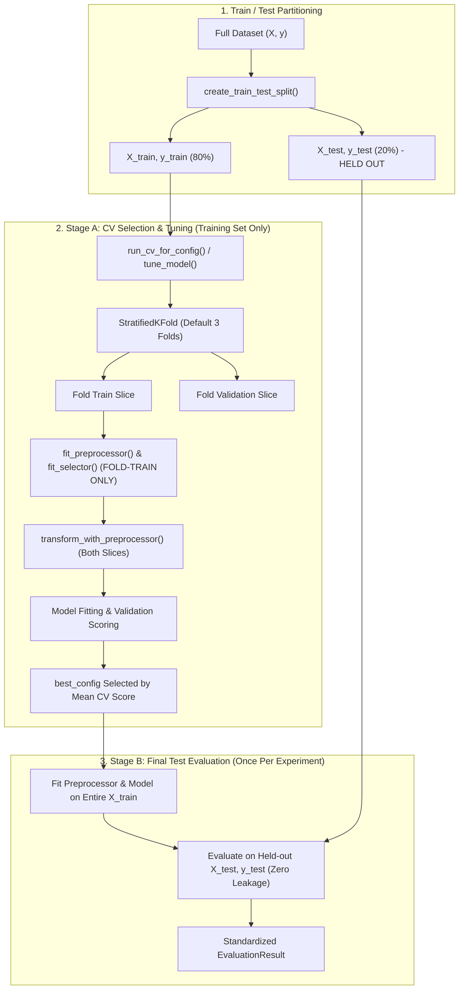

# Cross-Validation and Hyperparameter Tuning Architecture

## Overview

Day 18 introduces reproducible, strictly leakage-safe cross-validation (CV) and hyperparameter tuning for classical models in **QML Benchmark Studio**.

Supported Models:
- **Dummy Classifier** (`dummy`)
- **Support Vector Machine** (`svm`)
- **Multi-Layer Perceptron** (`mlp`)
- **Random Forest** (`random_forest`)

---

## 1. The Critical Leakage Safeguard

In machine learning and quantum-classical benchmarking, data leakage from validation or test partitions into preprocessing or feature selection leads to over-optimistic results and distorted scientific claims.

QML Benchmark Studio enforces a strict two-stage separation:



### Invariant Rules
1. **Fold-Local Fitting:** Every `PreprocessorArtifact` and `FeatureSelectorArtifact` is fitted **exclusively** on the training slice of that specific fold (`fold.train_indices`). The validation slice (`fold.val_indices`) is transformed without any refitting.
2. **Untouched Test Set:** The held-out test partition (`X_test`, `y_test`) is never passed to `run_cv_for_config()` or `tune_model()`. It participates exclusively in `final_evaluation()`.
3. **No Target Leakage in CV:** Class proportions are strictly preserved using stratified folds (`create_stratified_cv_splits`).

---

## 2. Cross-Validation Engine (`backend/training/cross_validation.py`)

### API
```python
def run_cv_for_config(
    model_name: str,
    config: Optional[Dict[str, Any]],
    X_train: pd.DataFrame,
    y_train: pd.Series,
    preprocessing_config: Optional[Union[Dict[str, Any], PreprocessingConfig]] = None,
    feature_selection_config: Optional[Union[Dict[str, Any], FeatureSelectionConfig]] = None,
    n_splits: int = 3,
    metric: str = "f1_macro",
    random_state: int = 42,
) -> CVResult
```

### Supported Metrics
| Metric Name | Implementation | Description |
|---|---|---|
| `f1_macro` (Default) | `sklearn.metrics.f1_score(..., average="macro")` | Unweighted average of per-class F1 scores. Robust to class imbalance. |
| `f1_weighted` | `sklearn.metrics.f1_score(..., average="weighted")` | Support-weighted average of per-class F1 scores. |
| `balanced_accuracy` | `sklearn.metrics.balanced_accuracy_score` | Average recall across all classes. |
| `accuracy` | `sklearn.metrics.accuracy_score` | Overall fraction of correct predictions. |

---

## 3. Hyperparameter Tuning Engine (`backend/training/hyperparameter_tuning.py`)

### API
```python
def tune_model(
    model_name: str,
    X_train: pd.DataFrame,
    y_train: pd.Series,
    preprocessing_config: Optional[Union[Dict[str, Any], PreprocessingConfig]] = None,
    feature_selection_config: Optional[Union[Dict[str, Any], FeatureSelectionConfig]] = None,
    custom_grid: Optional[List[Dict[str, Any]]] = None,
    max_candidates: int = 50,
    n_splits: int = 3,
    metric: str = "f1_macro",
    random_state: int = 42,
) -> TuningResult
```

### Search Grids (`DEFAULT_GRIDS`)

#### 1. Dummy Classifier (3 candidates)
- `strategy`: `["most_frequent", "stratified", "uniform"]`

#### 2. Support Vector Machine (9 candidates)
- **Linear Kernel (3 candidates):**
  - `C`: `[0.1, 1.0, 10.0]`
  - Note: `gamma` is excluded because linear kernels do not utilize gamma.
- **RBF Kernel (6 candidates):**
  - `C`: `[0.1, 1.0, 10.0]`
  - `gamma`: `["scale", "auto"]`

#### 3. Multi-Layer Perceptron (12 candidates)
- `hidden_layer_sizes`: `[(32,), (64,), (64, 32)]`
- `alpha`: `[0.0001, 0.001]`
- `learning_rate_init`: `[0.001, 0.01]`
- `max_iter`: `300`

#### 4. Random Forest (12 candidates)
- `n_estimators`: `[100, 200]`
- `max_depth`: `[None, 10, 20]`
- `min_samples_split`: `[2, 5]`

---

## 4. Final Evaluation (`final_evaluation`)

Once `tune_model` selects the best candidate on training data cross-validation:

```python
test_result = final_evaluation(
    model_name="svm",
    best_config=tuning_result.best_config,
    X_train=X_train,
    y_train=y_train,
    X_test=X_test,
    y_test=y_test,
    preprocessing_config=prep_cfg,
    feature_selection_config=fs_cfg,
)
```

The output dictionary contains:
- `stage`: `"final_test_evaluation"`
- `model_name`: canonical model identifier
- `config`: validated parameters (with tuples serialized as JSON lists)
- `metrics`: comprehensive metrics from `evaluate_predictions`
- `n_train`: full training set size
- `n_test`: held-out test set size
- `fit_time_seconds`: full retraining time
- `predict_time_seconds`: test inference latency
