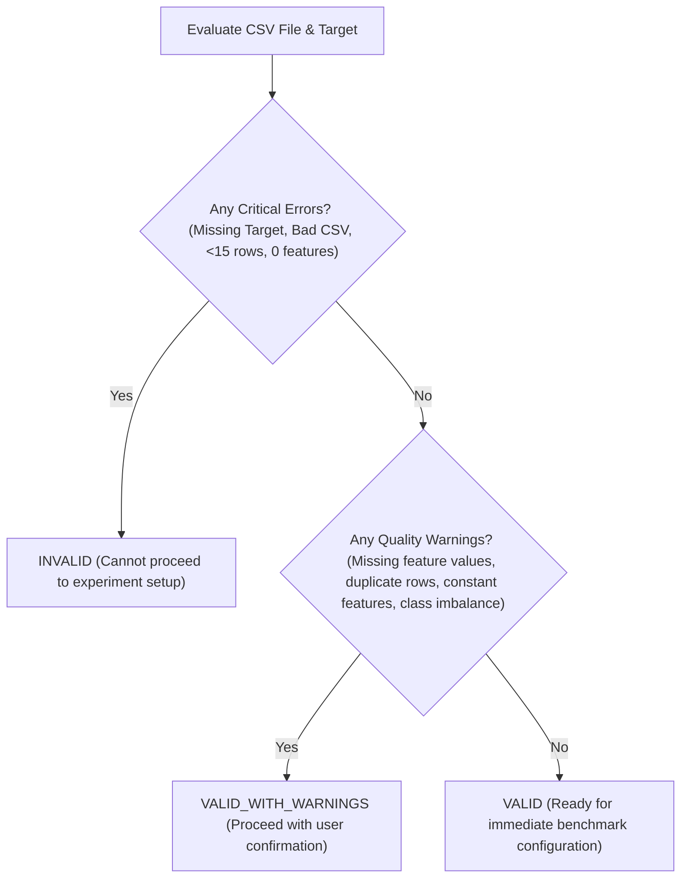

# CSV Upload & Dataset Validation Specification — QML Benchmark Studio

> **Status:** Formal Specification — Day 5, 2026-11-19  
> **Project:** 6th-Semester Research Project  
> **Repository:** https://github.com/BHARATHKUMAR-max/QUANTUM_SIMMULATOR  
> **Scope Reference:** [docs/MVP_SCOPE.md](MVP_SCOPE.md) · [docs/ARCHITECTURE.md](ARCHITECTURE.md)

---

## Table of Contents

1. [Overview & Guiding Principles](#1-overview--guiding-principles)
2. [File-Level Validation Rules](#2-file-level-validation-rules)
3. [Target Column Selection Rules](#3-target-column-selection-rules)
4. [Feature Column Validation Rules](#4-feature-column-validation-rules)
5. [Missing Values Strategy](#5-missing-values-strategy)
6. [Duplicate Records Policy](#6-duplicate-records-policy)
7. [Validation Outcomes Hierarchy](#7-validation-outcomes-hierarchy)
8. [User-Facing Validation Error & Warning Catalogue](#8-user-facing-validation-error--warning-catalogue)
9. [Future Validation Result Schema](#9-future-validation-result-schema)

---

## 1. Overview & Guiding Principles

The CSV Upload & Validation subsystem serves as the security and data health boundary for user-provided data in QML Benchmark Studio. Because downstream quantum simulations (`default.qubit` statevector evaluations) and classical baseline algorithms require well-defined numerical or safely encodable inputs, uploaded files must be rigorously audited before experiment execution.

### Guiding Principles
* **Zero Silent Truncation:** The system must **never** silently drop rows, remove columns, or alter target values during validation.
* **Deterministic Diagnostics:** Every issue must produce a stable error or warning code paired with an actionable user-facing explanation.
* **Leakage-Free Boundary:** Validation is strictly descriptive. Imputers, scalers, and encoders must **never** be fitted during validation.
* **Graceful Degradation:** Technical Python tracebacks and low-level C parser errors must be intercepted and translated into human-readable guidance.

---

## 2. File-Level Validation Rules

| Rule ID | Check Condition | Acceptance Criteria | Failure Severity | User Guidance |
|---|---|---|---|---|
| `FILE-01` | Extension check | Filename must end with `.csv` (case-insensitive). | `ERROR` | "Please select a standard comma-separated values (.csv) file." |
| `FILE-02` | Empty file detection | File size must be $> 0$ bytes and contain non-whitespace text. | `ERROR` | "The uploaded file is empty. Please select a CSV file containing headers and data." |
| `FILE-03` | Character encoding | File must be decodable as `UTF-8` or `UTF-8-SIG` (UTF-8 with BOM). | `ERROR` | "File encoding is not supported. Please save the CSV with UTF-8 encoding." |
| `FILE-04` | Delimiter & parsing | File must be parseable using standard comma delimiters without unescaped quote anomalies. | `ERROR` | "Unable to parse CSV structure. Verify that rows and quoted fields are properly formatted." |
| `FILE-05` | Header row presence | The first row must define column labels; all labels must be non-empty strings. | `ERROR` | "The CSV must contain a valid header row defining column names." |
| `FILE-06` | Unique column headers | Every column header in the first row must be unique. | `ERROR` | "Duplicate column names detected. Please ensure all column headers are unique." |
| `FILE-07` | Minimum row count | File must contain at least 15 valid data rows (excluding headers) to allow stratified train/test partitioning. | `ERROR` | "Dataset contains fewer than 15 rows. A minimum of 15 samples is required for benchmark splitting." |
| `FILE-08` | Inconsistent row lengths | Every row must contain the exact same number of fields as the header row. | `ERROR` | "Inconsistent field counts detected across rows. Ensure all records match the header structure." |

---

## 3. Target Column Selection Rules

Target selection dictates the supervised learning objective. The target column must be explicitly designated by the user; the system will never guess or silently default to the last column.

### 3.1 Rules Governing the Target Column
1. **Explicit Selection Mandatory (`TGT-01`):** An upload request without a designated `target_column` parameter returns validation status `VALID_WITH_WARNINGS` or `NEEDS_TARGET`, presenting available columns to the user for selection.
2. **Column Existence (`TGT-02`):** The specified target column name must exist in the CSV header.
3. **Isolation from Features (`TGT-03`):** The target column is strictly isolated from the feature matrix $X$ and cannot be used as an input attribute.
4. **Zero Missing Target Values (`TGT-04`):** Target labels must be complete. If any row contains a null, empty, or NaN target value, validation fails (`ERROR`). The system will not silently drop rows.
5. **Classification Class Count (`TGT-05`):** Target values must exhibit at least two distinct classes ($C \ge 2$) for classification. A target with a single unique value is rejected (`ERROR`).
6. **Binary & Multiclass Support (`TGT-06`):** The system natively supports binary ($C = 2$) and multiclass ($C \ge 3$) targets. Original string, integer, or boolean class labels are preserved and mapped to deterministic integer indices.
7. **Severe Class Imbalance Warning (`TGT-07`):** If the minority class represents $< 20\%$ of total samples, a warning (`WARNING`) is raised recommending stratified cross-validation.
8. **Extreme High Cardinality Warning (`TGT-08`):** If the target contains $> 20$ unique classes or unique values exceed $50\%$ of row count, validation flags an error/warning suggesting the column may be a continuous target (regression) or unique ID rather than a classification class.

---

## 4. Feature Column Validation Rules

All columns other than the selected target are categorized as candidate feature attributes.

### 4.1 Numerical Columns
* Accepted types: Standard 32-bit/64-bit integers (`int32`, `int64`) and floating-point values (`float32`, `float64`).
* **Infinite & Non-Finite Values (`FEAT-01`):** Features containing `inf`, `-inf`, or non-numerical strings in numeric columns fail validation (`ERROR`).
* **Constant Features (`FEAT-02`):** Features with zero variance ($\sigma^2 = 0$) are flagged as `WARNING`. They are retained during validation, and the user is informed that feature selection will likely eliminate them.
* **Near-Constant Features (`FEAT-03`):** Features with variance $< 10^{-4}$ are flagged with an informational `WARNING`.

### 4.2 Categorical Columns
* Accepted types: String categories, text labels, and boolean flags (`True`/`False`).
* **High-Cardinality Detection (`FEAT-04`):** If a categorical column contains $> 50$ distinct categories or more than $80\%$ unique values (e.g. UUIDs, names, serial numbers), validation flags a `WARNING` advising that the feature is likely an identifier and should be excluded.
* **Mixed Data Types (`FEAT-05`):** Columns containing arbitrary mixtures of numbers, dates, and prose text that cannot be parsed unambiguously trigger an `ERROR`.

### 4.3 Datetime and Unsupported Columns
* **Datetime Detection (`FEAT-06`):** Columns formatted as ISO timestamps, calendar dates, or clock times are flagged as `WARNING` (`DATETIME_DETECTED`). Datetime features are not silently converted into epoch integers; the user is advised to extract numerical components (e.g. day, hour) beforehand.

---

## 5. Missing Values Strategy

The platform maintains distinct policies for target columns versus feature columns:

```text
               ┌───────────────────────────────┐
               │    Missing Value Detected?    │
               └──────────────┬────────────────┘
                              │
             ┌────────────────┴────────────────┐
             ▼                                 ▼
   Target Column (y)                  Feature Columns (X)
  ─────────────────────              ─────────────────────
  • Status: INVALID                  • Status: VALID_WITH_WARNINGS
  • Action: Validation FAILS         • Action: Report missing % per column
  • Reason: Cannot infer labels      • Preprocessing: Impute during Step 4
  • Prohibition: NO silent drop      • Prohibition: NO imputer fit on test
```

* **Target Columns:** Any missing label in $y$ makes supervised learning ill-posed. Rows are not silently deleted; the user must repair the file.
* **Feature Columns:** Missing values are permitted during validation. The validation report specifies exact counts and percentages per column. If an entire column is empty ($100\%$ null), validation issues an `ERROR` (`FEAT_ALL_NULL`).

---

## 6. Duplicate Records Policy

* **Duplicate Rows (`DUP-01`):** Complete duplicate rows are counted and reported under `duplicate_summary` as a `WARNING`. Rows are **not** automatically removed, because duplication in experimental benchmarks can reflect legitimate repeated observations, and removing rows alters class distributions.
* **Duplicate Feature Columns (`DUP-02`):** Columns with identical values across all rows are flagged as `WARNING`.
* **Duplicate Column Headers (`DUP-03`):** Multiple columns sharing the identical header name are strictly rejected with an `ERROR` (`INVALID`), as ambiguous column references prevent deterministic feature selection.

---

## 7. Validation Outcomes Hierarchy

The validation subsystem computes a single top-level outcome from its audit:



1. **`VALID`:** All structural, target, and feature invariants are satisfied. The dataset is ready for experiment configuration.
2. **`VALID_WITH_WARNINGS`:** No fatal errors exist, but potential data hygiene issues (e.g., missing feature values, moderate class imbalance, duplicate rows) were identified and surfaced in the report.
3. **`INVALID`:** One or more fatal errors prevent safe execution. The experiment cannot be launched until the user uploads a compliant file or corrects parameters.

---

## 8. User-Facing Validation Error & Warning Catalogue

The catalogue below establishes stable diagnostic codes, severity tiers, human-readable explanations, and concrete remediation steps:

| Error Code | Severity | Trigger Condition | User-Facing Message | Recommended User Action |
|---|---|---|---|---|
| `FILE_EMPTY` | `ERROR` | File length is 0 bytes. | "The uploaded file is empty. Please select a CSV file containing data." | Check the selected file on your computer and select a valid non-empty file. |
| `FILE_UNSUPPORTED_EXT` | `ERROR` | Extension is not `.csv`. | "Unsupported file format. Only standard comma-separated (.csv) files are supported." | Export or save your table as a `.csv` file and re-upload. |
| `FILE_ENCODING_ERROR` | `ERROR` | Byte sequence violates UTF-8. | "Unable to read file text encoding. Please ensure the CSV is saved using standard UTF-8." | Re-save the file in your spreadsheet editor selecting 'CSV UTF-8 (Comma delimited)'. |
| `FILE_PARSE_ERROR` | `ERROR` | CSV parser fails on malformed quotes or delimiters. | "Malformed CSV structure detected. Verify that quotation marks and row delimiters are well-formed." | Inspect the file around the flagged line for unclosed quotes or stray delimiter characters. |
| `FILE_ROW_COUNT_LOW` | `ERROR` | Dataset contains $< 15$ rows. | "Insufficient data rows. The dataset contains fewer than 15 rows, which is too small for benchmark splitting." | Ensure the dataset contains at least 15 observations. |
| `COL_DUPLICATE_NAMES` | `ERROR` | Two or more headers have identical names. | "Duplicate column headers detected. Column names must be unique to avoid ambiguous feature selection." | Rename the duplicated column headers in your CSV file. |
| `TARGET_NOT_SPECIFIED` | `ERROR` | No target column was selected. | "No target column selected. Please designate which column represents the prediction target." | Select the target column name from the available columns dropdown. |
| `TARGET_NOT_FOUND` | `ERROR` | Selected target name not in headers. | "Selected target column was not found in the uploaded file." | Select a column that exists in the header list. |
| `TARGET_HAS_NULLS` | `ERROR` | Target column contains missing values. | "The target column contains missing values. Supervised classification requires complete target labels." | Provide labels for all rows or remove unlabelled rows from the CSV file. |
| `TARGET_SINGLE_CLASS` | `ERROR` | Target column has only 1 unique class. | "This dataset contains only one target class. Classification requires at least two distinct classes." | Ensure the target column includes samples from at least two different classes. |
| `TARGET_HIGH_CARDINALITY` | `ERROR` | Target contains $> 20$ unique classes or $> 50\%$ unique rows. | "The target column has an unusually high number of unique classes. Verify that this is not an ID or continuous number." | Confirm that the chosen target column represents discrete classification categories. |
| `TARGET_CLASS_IMBALANCE` | `WARNING` | Minority class represents $< 20\%$ of data. | "Class imbalance detected: The minority class represents less than 20% of samples." | Consider enabling stratified splitting to preserve class proportions. |
| `FEAT_ALL_NULL` | `ERROR` | A column contains 100% missing values. | "Column contains entirely missing values and cannot be used as a feature." | Remove or populate the empty column. |
| `FEAT_HAS_NULLS` | `WARNING` | Numerical/categorical column has missing values. | "Missing values detected in feature columns. Missing values will be imputed during preprocessing." | No action needed if mean/median imputation is acceptable; otherwise, clean missing values prior to upload. |
| `FEAT_INFINITE_VALUES` | `ERROR` | Numeric feature contains `inf` or `-inf`. | "Infinite values detected in numeric features. Mathematical models cannot process infinite inputs." | Replace infinite entries with finite numbers or null indicators. |
| `FEAT_CONSTANT` | `WARNING` | Feature has zero variance ($\sigma^2 = 0$). | "Zero-variance constant feature detected. This feature contains identical values across all rows." | Constant features provide no predictive signal and will likely be eliminated by feature selection. |
| `FEAT_NEAR_CONSTANT` | `WARNING` | Feature variance is $< 10^{-4}$. | "Near-constant feature detected. This feature displays very low variance across samples." | Informational note; feature selection will evaluate whether this feature is informative. |
| `FEAT_HIGH_CARDINALITY` | `WARNING` | Categorical feature has $> 50$ classes or $> 80\%$ unique entries. | "High-cardinality categorical feature detected. This column may be an identifier (e.g. ID, name)." | Verify whether this column is a unique identifier that should be excluded from training. |
| `FEAT_DATETIME_DETECTED`| `WARNING` | Column format matches date/time patterns. | "Date or timestamp format detected. Datetime columns are not automatically converted into numerical features." | Extract numerical components (such as day of week, hour, or elapsed seconds) if you wish to use time signals. |
| `DUP_ROWS_DETECTED` | `WARNING` | Identical rows exist in the dataset. | "Duplicate rows detected. Duplicate records are retained to preserve original data distribution." | Review whether repeated rows represent genuine repeated measurements or accidental duplicates. |
| `DUP_COLS_DETECTED` | `WARNING` | Two distinct feature columns contain identical values. | "Duplicate feature values detected across two columns. Both columns provide identical information." | One of the redundant columns can be removed during feature selection. |

---

## 9. Future Validation Result Schema

The future FastAPI endpoint `POST /api/datasets/upload` will return a structured JSON response conforming to the schema below:

```json
{
  "validation_status": "VALID_WITH_WARNINGS",
  "filename": "customer_churn_sample.csv",
  "file_size_bytes": 142850,
  "row_count": 1000,
  "column_count": 15,
  "selected_target": "churn",
  "target_summary": {
    "target_name": "churn",
    "num_classes": 2,
    "class_counts": {
      "No": 734,
      "Yes": 266
    },
    "class_percentages": {
      "No": 73.4,
      "Yes": 26.6
    },
    "majority_class": "No",
    "minority_class": "Yes",
    "imbalance_ratio": 2.76
  },
  "columns": {
    "feature_columns": [
      "tenure", "monthly_charges", "total_charges", "contract_type"
    ],
    "numerical_columns": [
      "tenure", "monthly_charges", "total_charges"
    ],
    "categorical_columns": [
      "contract_type"
    ]
  },
  "missing_value_summary": {
    "total_missing_values": 11,
    "columns_with_missing": [
      {
        "column_name": "total_charges",
        "missing_count": 11,
        "missing_percentage": 1.1
      }
    ]
  },
  "duplicate_summary": {
    "duplicate_row_count": 0,
    "duplicate_feature_groups": []
  },
  "constant_feature_summary": {
    "zero_variance_features": [],
    "low_variance_features": []
  },
  "warnings": [
    {
      "code": "FEAT_HAS_NULLS",
      "severity": "WARNING",
      "affected_column": "total_charges",
      "message": "Missing values detected in feature column 'total_charges' (11 missing values, 1.1%).",
      "suggested_action": "Missing values will be handled by the configured preprocessor (imputation)."
    }
  ],
  "errors": []
}
```
