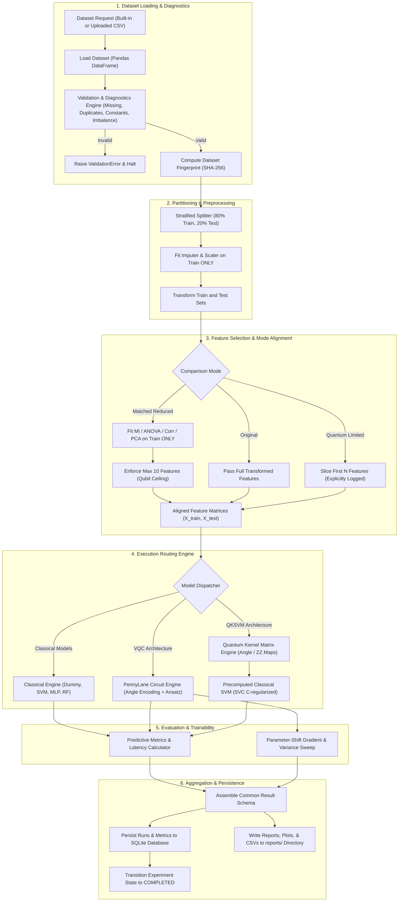
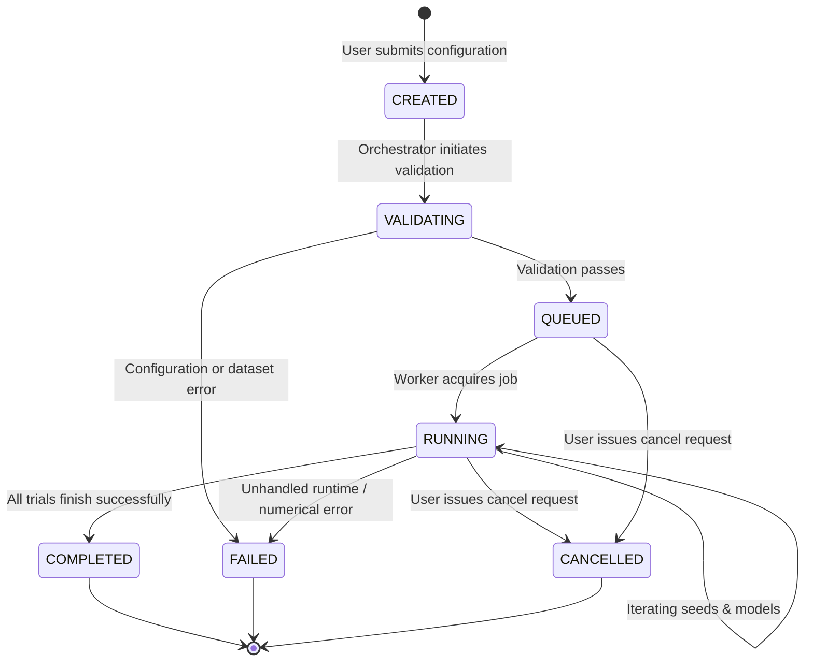
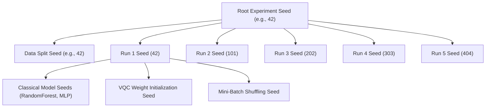
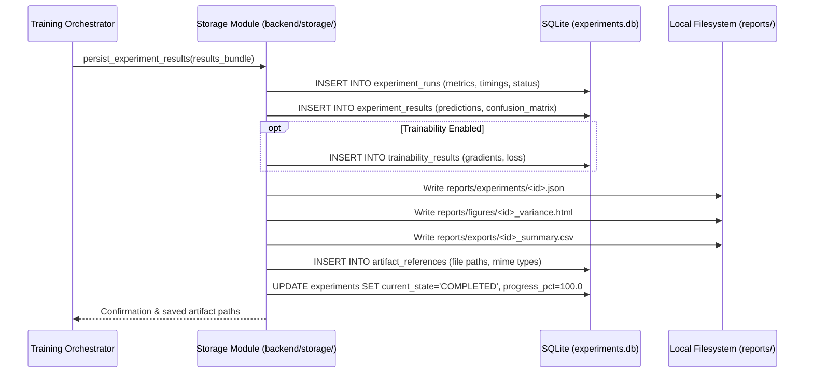

# Data Flow & Lifecycle Design — QML Benchmark Studio

> **Status:** Formal Specification — Day 3, 2026-11-19  
> **Project:** 6th-Semester Research Project  
> **Repository:** https://github.com/BHARATHKUMAR-max/QUANTUM_SIMMULATOR  
> **Companion Document:** [Architecture Specification](ARCHITECTURE.md)

---

## Table of Contents

1. [Experiment Data Flow Diagram](#1-experiment-data-flow-diagram)
2. [Step-by-Step Processing Lifecycle](#2-step-by-step-processing-lifecycle)
3. [Model Execution Routing](#3-model-execution-routing)
4. [Experiment State Machine](#4-experiment-state-machine)
5. [Random Seed & Reproducibility Strategy](#5-random-seed--reproducibility-strategy)
6. [Storage & Artifact Export Flow](#6-storage--artifact-export-flow)

---

## 1. Experiment Data Flow Diagram

The diagram below traces an experiment from user submission in React to final persistence in SQLite and artifact storage.

---

## 2. Step-by-Step Processing Lifecycle

### STEP 1 — Dataset Loading
* Loads either scikit-learn built-ins (`breast_cancer`, `wine`) or user-uploaded CSV files.
* Identifies continuous and categorical feature matrices $X$ and ground-truth target vector $y$.
* Retains dataset metadata: source provenance, raw sample count, raw feature count, and class taxonomy.

### STEP 2 — Dataset Validation & Profiling
* Inspects data types, checking for non-numeric columns that require explicit encoding.
* Identifies missing entries ($NaN$) and computes column-wise missing percentages.
* Detects and reports duplicate rows.
* Identifies zero-variance constant features (features where $\sigma = 0$).
* Calculates class distribution ratios and raises an explicit warning if the minority class represents $< 20\%$ of samples.
* Halts execution with structured errors if the dataset contains zero valid features or fewer than 10 total instances.

### STEP 3 — Train/Test Splitting
* Splits the dataset into 80% training and 20% testing subsets using stratified sampling based on $y$.
* An explicit `random_seed` governs the partitioning to guarantee identical split indices across runs.
* **Strict Boundary Rule:** The test partition $(X_{\text{test}}, y_{\text{test}})$ is isolated immediately and stored in memory without being exposed to any transformation fitting.

### STEP 4 — Preprocessing
* `SimpleImputer` fits on $X_{\text{train}}$ only and imputes $X_{\text{train}}$ and $X_{\text{test}}$.
* `StandardScaler` fits exclusively on the imputed $X_{\text{train}}$:
  $$\mu = \frac{1}{N_{\text{train}}} \sum_{i=1}^{N_{\text{train}}} x_i, \quad \sigma = \sqrt{\frac{1}{N_{\text{train}}} \sum_{i=1}^{N_{\text{train}}} (x_i - \mu)^2}$$
* $X_{\text{test}}$ is transformed using the stored $\mu$ and $\sigma$ from $X_{\text{train}}$. No statistics are calculated over $X_{\text{test}}$.

### STEP 5 — Feature Selection and Dimensionality Reduction
* Selects features or performs dimensionality reduction according to the configured method:
  * **Mutual Information:** `SelectKBest(mutual_info_classif)` fitted solely on $(X_{\text{train}}, y_{\text{train}})$.
  * **ANOVA F-test:** `SelectKBest(f_classif)` fitted solely on $(X_{\text{train}}, y_{\text{train}})$.
  * **Correlation Filtering:** Pearson correlation matrix evaluated on $X_{\text{train}}$ only; redundant features dropping above threshold (default 0.95).
  * **PCA:** `PCA(n_components=k)` fitted on scaled $X_{\text{train}}$ only.
* Maps selected feature masks or projection matrices to $X_{\text{test}}$.
* Logs the exact list of retained features and transformation duration.

### STEP 6 — Model Preparation
* Adapts features for consumption based on the comparison mode:
  1. **Original Features:** Classical baselines receive all preprocessed features; quantum models evaluate if raw feature count $\le 10$.
  2. **Matched Reduced Features (Primary Fair Mode):** Both classical and quantum models receive the identical reduced feature subset ($k \le 10$).
  3. **Quantum-Limited Features:** Classical models receive the full feature set; quantum models receive the reduced set.
* Rejects any configuration where quantum input dimension exceeds 10 features (enforcing the 10-qubit simulator ceiling).

### STEP 7 — Model Training
* Routes execution to the designated model engine:
  * **Classical Baselines:** Instantiates `DummyClassifier`, `SVC`, `MLPClassifier`, or `RandomForestClassifier`. Fits on $(X_{\text{train}}, y_{\text{train}})$.
  * **VQC:** Configures a PennyLane QNode on `default.qubit` with $N$ wires. Encodes input vectors via angle rotations, applies variational layers with linear or circular CNOT gates, and optimizes weights via Adam or COBYLA.
  * **Quantum Kernel SVM:** Constructs the training Gram matrix $K_{ij} = |\langle\phi(x_i)|\phi(x_j)\rangle|^2$ for all training pairs up to the 200-sample cap. Fits classical `SVC(kernel='precomputed')`.

### STEP 8 — Evaluation
* Collects test predictions $\hat{y}_{\text{test}}$ and probability tensors $P(y|x)$ on $X_{\text{test}}$.
* Computes standard performance metrics: Accuracy, Macro Precision, Macro Recall, Macro F1, Weighted F1, Balanced Accuracy, ROC-AUC (OvR macro), and confusion matrices.
* Records fine-grained timing intervals: preprocessing time, feature selection time, training duration, and inference latency.

### STEP 9 — Trainability Analysis
* When enabled for VQC, executes the research trainability protocol:
  * Sweeps across qubit widths $\{2, 4, 6, 8, 10\}$ and depths $\{1, 2, 3, 4\}$.
  * Evaluates parameter gradients via PennyLane's parameter-shift rule across multiple random initializations (10, 20, or 30).
  * Calculates gradient norms, gradient component variance, and records training and validation loss dynamics per epoch.

### STEP 10 — Result Aggregation
* Formats raw outputs into the standard `experiment_result.schema.json` structure.
* Aggregates multi-seed iterations, calculating mean and sample standard deviations for all metrics and execution times.

### STEP 11 — Storage and Reporting
* Writes relational execution metadata and summary metrics to SQLite tables.
* Writes full JSON payloads to `reports/experiments/<experiment_id>.json`.
* Saves rendered Plotly HTML figures and distribution PNGs to `reports/figures/`.
* Writes CSV comparison sheets to `reports/exports/`.

---

## 3. Model Execution Routing

The table below summarizes how model requests are dispatched, what input structures they require, and how outputs are gathered:

| Model ID | Execution Engine | Input Representation | Training Dispatch | Output Representation |
|---|---|---|---|---|
| `dummy` | Classical (`scikit-learn`) | Dense NumPy array $(N, D)$ | `DummyClassifier.fit(X, y)` | Integer array $\hat{y}$, Class priors |
| `svm` | Classical (`scikit-learn`) | Standardized array $(N, D)$ | `SVC.fit(X, y)` | Integer array $\hat{y}$, Calibrated probabilities |
| `mlp` | Classical (`scikit-learn`) | Standardized array $(N, D)$ | `MLPClassifier.fit(X, y)` | Integer array $\hat{y}$, Softmax probabilities |
| `random_forest` | Classical (`scikit-learn`) | Standardized array $(N, D)$ | `RandomForestClassifier.fit(X, y)` | Integer array $\hat{y}$, Voting probabilities |
| `vqc` | Quantum (`PennyLane default.qubit`) | Angle-scaled array $(N, D), D \le 10$ | Custom Adam / COBYLA QNode loop | Argmax expectation $\hat{y}$, Normalized expectations |
| `qksvm` | Hybrid (`PennyLane` + `scikit-learn`) | Feature mapped statevectors $(N, D), D \le 10$ | Gram matrix computation $\to$ `SVC(precomputed).fit(K, y)` | Support vector projection $\hat{y}$, Decision margins |

---

## 4. Experiment State Machine

Every experiment transitions through a deterministic state machine managed by the orchestration engine.

### State Transition Matrix

| Current State | Next State | Triggering Condition | Recorded Data / Side Effects |
|---|---|---|---|
| `CREATED` | `VALIDATING` | Experiment received by API endpoint. | Generates `experiment_id` UUID, records initial timestamp. |
| `VALIDATING` | `QUEUED` | Schema, dataset path, and hyperparameter checks pass. | Persists immutable configuration snapshot to SQLite. |
| `VALIDATING` | `FAILED` | Schema violation or invalid column request. | Records `error_details` with validation message. |
| `QUEUED` | `RUNNING` | Execution loop picks up experiment. | Updates `started_at`, marks `progress_percentage = 0.0`. |
| `QUEUED` | `CANCELLED` | User aborts job before processing starts. | Sets state to `CANCELLED`, records cancellation timestamp. |
| `RUNNING` | `RUNNING` | Individual seed or model trial finishes. | Increments `models_completed`, updates `progress_percentage`. |
| `RUNNING` | `COMPLETED` | All model trials and multi-seed sweeps succeed. | Aggregates mean/std metrics, writes JSON/CSV, sets `completed_at`. |
| `RUNNING` | `FAILED` | Quantum simulation or optimization throws fatal error. | Stores stack trace, model name, seed index, and marks `FAILED`. |
| `RUNNING` | `CANCELLED` | User aborts job during model training. | Terminates loop, stores partial progress, marks `CANCELLED`. |

---

## 5. Random Seed & Reproducibility Strategy

Reproducibility is essential for fair benchmarking between classical and quantum models. The system uses a hierarchical seed derivation strategy.

### 5.1 Controlled Random Subsystems
1. **Python Runtime:** `random.seed(seed)` set at the start of each trial.
2. **NumPy Global & Generator:** `np.random.seed(seed)` and instance-level `default_rng(seed)` initialized.
3. **Scikit-Learn Baselines:** `random_state=seed` explicitly passed to `train_test_split`, `RandomForestClassifier`, and `MLPClassifier`.
4. **PennyLane Parameter Initialization:** Initial variational angles $\theta \sim \mathcal{U}(0, 2\pi)$ sampled using a NumPy generator seeded with the trial's specific seed.
5. **Multi-Seed Evaluation:** By default, 5 seeds are evaluated (`[42, 101, 202, 303, 404]`), and results are reported as:
   $$\mu = \frac{1}{S} \sum_{s=1}^S m_s, \quad \sigma = \sqrt{\frac{1}{S-1} \sum_{s=1}^S (m_s - \mu)^2}$$

### 5.2 Reproducibility Disclaimer
> **Note on Cross-Platform Reproducibility:** Exact bit-for-bit numerical reproducibility is guaranteed only when running on identical operating systems, Python versions, NumPy versions, and underlying linear algebra libraries (BLAS/LAPACK/OpenBLAS). Across different processor architectures, floating-point rounding variations may produce slight numerical drift.

---

## 6. Storage & Artifact Export Flow

When an experiment reaches `COMPLETED`, the storage layer handles persistence across relational and filesystem storage:

