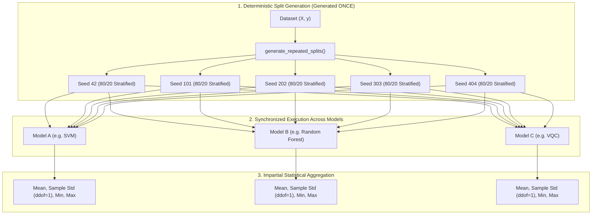

# Repeated Runs and Result Aggregation Specification

## Overview

Day 19 implements a reproducible repeated-experiment execution and statistical aggregation framework in **QML Benchmark Studio**. 

This system measures model performance stability across multiple stratified train/test partitions, ensuring fair comparisons between classical baselines and future quantum classifiers without making unwarranted claims of statistical significance.

---

## 1. Five-Run Experiment Protocol

The default benchmark protocol specifies:

| Parameter | Default Value | Description |
|---|---|---|
| Repetitions (`n_repeats`) | `5` | Five independent train/test partitions. |
| Test Partition Ratio (`test_size`) | `0.20` (20%) | Held-out test set evaluated exactly once per repetition. |
| Training Partition Ratio | `0.80` (80%) | Used for preprocessing fitting, optional tuning, and model training. |
| Stratification | `True` | Class proportions preserved across train and test partitions. |
| Default Random Seeds | `[42, 101, 202, 303, 404]` | Agreed deterministic seed sequence. |

---

## 2. Multi-Model Fair Comparison Architecture

To ensure impartial and scientifically valid benchmarking, multiple models must never be evaluated on independently randomized splits. Instead, partitions are generated once and shared across all models.



### Invariants:
1. **Identical Indices:** For any repetition $k \in \{0, 1, 2, 3, 4\}$, every model receives the exact same training indices and test indices.
2. **Fresh Estimators:** Preprocessing (`ColumnTransformer`), feature selectors (`SelectKBest`), and models are instantiated fresh for every repetition. No fitted state persists across runs.
3. **Strict Isolation:** Preprocessing and feature selection are fitted **exclusively on that run's training slice**. Test partitions are transformed only.

---

## 3. Experiment Execution Modes

### Mode A: Fixed Configuration (`mode="fixed"`, Default)
- Uses the supplied validated model configuration across all 5 repetitions.
- No hyperparameter search is performed.
- Suitable for standard baseline evaluation and computationally constrained models.

### Mode B: Tuned Within Repetition (`mode="tuned"`)
- Executes cross-validation hyperparameter search (using Day 18 `tune_model`) **strictly within that repetition's 80% training slice**.
- Selected hyperparameters may differ between repetitions based on training partition variation.
- The best configuration selected by CV is refitted on the full 80% training slice and evaluated on the held-out 20% test partition.
- Test data **never participates** in parameter tuning.

---

## 4. Aggregation Methodology

For each model and metric, the following statistics are calculated across valid runs:

- **Mean:** $\bar{x} = \frac{1}{N} \sum_{i=1}^N x_i$
- **Sample Standard Deviation:** $s = \sqrt{\frac{1}{N-1} \sum_{i=1}^N (x_i - \bar{x})^2}$ (using Bessel's correction, `ddof=1` for $N \ge 2$).
- **Single-Run Guard:** If only one repetition succeeds ($N=1$), sample standard deviation is returned as `None` (not $0.0$).
- **Minimum and Maximum:** Extrema across successful runs.
- **Run Accounting:** `successful_runs` and `failed_runs` are recorded explicitly.

### Missing Metric Conventions
- Non-applicable metrics (such as ROC-AUC for non-probabilistic classifiers or models without predicted probabilities) are **excluded** from calculation.
- Missing values are **NEVER** silently imputed as zero.
- The valid count reflects the number of runs where that specific metric was mathematically well-defined.

---

## 5. Statistical Interpretation & Honest Reporting

> [!WARNING]
> **Important Statistical Limitations:**
> - Five repetitions provide an initial estimate of performance variability across data splits.
> - **Five runs do not provide sufficient statistical power for formal hypothesis testing or significance claims** (e.g. p-values or confidence intervals).
> - Small differences in mean performance should be considered exploratory and not interpreted as definitive evidence of model superiority.
> - No claims of quantum advantage or superiority may be made based solely on five-run sample means.

---

## 6. Code Examples

### Single Model Repeated Experiment
```python
from backend.training.repeated_runs import run_repeated_experiment

result = run_repeated_experiment(
    X=X,
    y=y,
    model_name="svm",
    model_config={"kernel": "linear", "C": 1.0},
    n_repeats=5,
    test_size=0.2,
    stratify=True,
    mode="fixed",
)

f1_agg = result.aggregates["f1_macro"]
print(f"SVM 5-Run F1 Macro: {f1_agg.mean:.4f} ± {f1_agg.std:.4f}")
```

### Fair Multi-Model Comparison
```python
from backend.training.repeated_runs import run_repeated_comparison

comparison = run_repeated_comparison(
    X=X,
    y=y,
    models=["dummy", "svm", "random_forest"],
    n_repeats=5,
    test_size=0.2,
    stratify=True,
)

for model_name, model_res in comparison.model_results.items():
    agg = model_res.aggregates["f1_macro"]
    print(f"{model_name:15s}: Mean={agg.mean:.4f}, Std={agg.std:.4f}")
```
