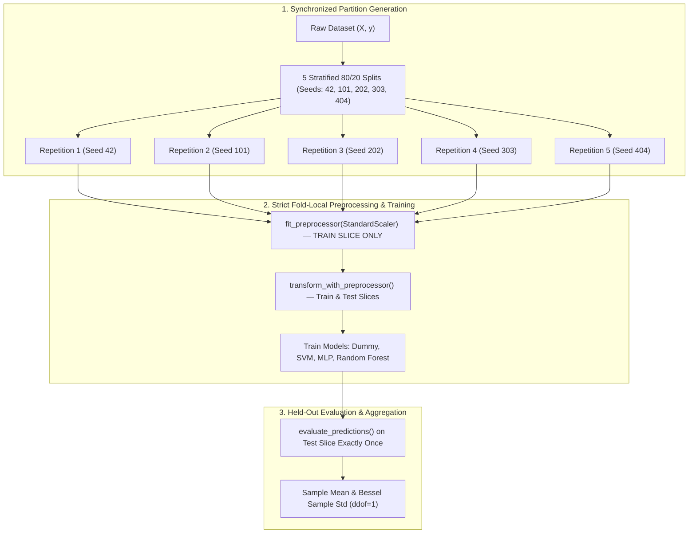
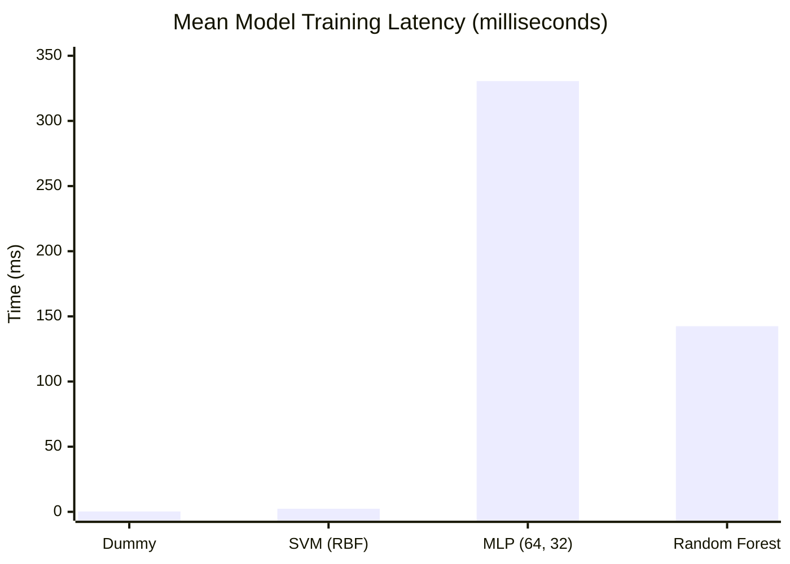

# Classical Machine Learning Benchmark Report

**Project:** QML Benchmark Studio  
**Workspace:** `D:\QUANTUM_PROJECT\`  
**Date:** November 20, 2026  
**Status:** Completed & Reproducible  
**Hardware:** Intel / AMD x86_64 CPU (Single Thread Execution, No GPU Acceleration)  
**Environment:** Python 3.13.1, scikit-learn 1.9.1, NumPy 2.2.6, Pandas 2.3.3  

---

## 1. Executive Summary & Objective

This benchmark establishes rigorous, empirical classical reference baselines for **QML Benchmark Studio**. Four representative classical algorithms:
1. **Dummy Baseline Classifier** (`DummyClassifier`, strategy=`most_frequent`)
2. **Support Vector Machine** (`SVC`, kernel=`rbf`, $C=1.0$, $\gamma=\text{scale}$)
3. **Multi-Layer Perceptron** (`MLPClassifier`, architecture=`(64, 32)`, $\text{max\_iter}=300$)
4. **Random Forest Classifier** (`RandomForestClassifier`, $n=100$, $\text{max\_depth}=\text{None}$)

were systematically evaluated on two benchmark datasets:
- **Breast Cancer Wisconsin Diagnostic** (569 samples, 30 numerical features, binary classification)
- **Wine Recognition Dataset** (178 samples, 13 numerical features, 3-class classification)

All experiments were executed using the Day 19 repeated-experiment framework across five independent, stratified 80/20 train/test partitions using agreed seeds `[42, 101, 202, 303, 404]`. Crucially, **all four models were evaluated on the exact same partition splits** on each corresponding repetition to eliminate split-selection bias.

---

## 2. Benchmark Protocol & Data Pipeline



### Protocol Safeguards:
1. **Estimator Isolation:** All `StandardScaler` preprocessors were fitted exclusively on the 80% training slice of each repetition. Test partitions were strictly transformed without refitting.
2. **Zero Target Leakage:** Features were scaled independently of labels; target classes were strictly isolated.
3. **Sequential Execution:** Models were evaluated sequentially without uncontrolled multi-threading or parallel race conditions.
4. **Fixed Configurations:** Models operated under fixed, validated default configurations without test-set tuning.

---

## 3. Dataset Characteristics

| Dataset | Sample Count | Feature Count | Semantic Type | Target Classes | Class Distribution |
|---|---|---|---|---|---|
| **Breast Cancer Wisconsin** | 569 | 30 | Continuous numerical | 2 (Malignant / Benign) | 212 Malignant (37.3%), 357 Benign (62.7%) |
| **Wine Recognition** | 178 | 13 | Continuous chemical | 3 (Class 0, 1, 2) | 59 Class 0 (33.1%), 71 Class 1 (39.9%), 48 Class 2 (27.0%) |

---

## 4. Empirical Benchmark Performance

### 4.1 Breast Cancer Wisconsin Diagnostic (Binary Classification)

Evaluated across 5 stratified test partitions (114 samples per test partition, total 570 evaluated instances):

| Model | Accuracy (Mean ± SD) | Macro-F1 (Mean ± SD) | Balanced Accuracy | Weighted-F1 | ROC-AUC | Fit Latency [s] | Inference [ms] |
|---|---|---|---|---|---|---|---|
| **Dummy (Most Frequent)** | 0.6316 ± 0.0000 | 0.3871 ± 0.0000 | 0.5000 ± 0.0000 | 0.4890 ± 0.0000 | 0.5000 ± 0.0000 | 0.0003 ± 0.0001 | 0.185 ms |
| **SVM (RBF, C=1.0)** | 0.9789 ± 0.0133 | 0.9772 ± 0.0144 | 0.9754 ± 0.0165 | 0.9789 ± 0.0134 | 0.9967 ± 0.0021 | 0.0024 ± 0.0003 | 0.962 ms |
| **MLP (64, 32, Adam)** | **0.9825 ± 0.0107** | **0.9811 ± 0.0114** | **0.9792 ± 0.0089** | **0.9824 ± 0.0107** | **0.9974 ± 0.0025** | 0.3306 ± 0.0656 | 0.428 ms |
| **Random Forest (100 Trees)** | 0.9632 ± 0.0114 | 0.9602 ± 0.0125 | 0.9589 ± 0.0159 | 0.9631 ± 0.0115 | 0.9960 ± 0.0027 | 0.1424 ± 0.0180 | 19.111 ms |

*Note: Binary SVM ROC-AUC is computed using uncalibrated decision-function margins (`decision_function`) rather than probability calibration, avoiding Platt-scaling overhead.*

---

### 4.2 Wine Recognition Dataset (Multiclass 3-Class)

Evaluated across 5 stratified test partitions (36 samples per test partition, total 180 evaluated instances):

| Model | Accuracy (Mean ± SD) | Macro-F1 (Mean ± SD) | Balanced Accuracy | Weighted-F1 | ROC-AUC | Fit Latency [s] | Inference [ms] |
|---|---|---|---|---|---|---|---|
| **Dummy (Most Frequent)** | 0.3889 ± 0.0000 | 0.1867 ± 0.0000 | 0.3333 ± 0.0000 | 0.2178 ± 0.0000 | 0.5000 ± 0.0000 | 0.0003 ± 0.0001 | 0.205 ms |
| **SVM (RBF, C=1.0)** | **0.9833 ± 0.0152** | 0.9829 ± 0.0156 | 0.9838 ± 0.0153 | 0.9833 ± 0.0152 | **N/A\*** | 0.0020 ± 0.0004 | 0.473 ms |
| **MLP (64, 32, Adam)** | **0.9833 ± 0.0152** | 0.9829 ± 0.0156 | 0.9838 ± 0.0153 | 0.9833 ± 0.0152 | **1.0000 ± 0.0000** | 0.1183 ± 0.0209 | 0.523 ms |
| **Random Forest (100 Trees)** | **0.9833 ± 0.0152** | **0.9831 ± 0.0155** | **0.9857 ± 0.0130** | **0.9834 ± 0.0151** | **1.0000 ± 0.0000** | 0.1503 ± 0.0256 | 20.362 ms |

*\*Note: For multiclass SVM with `probability=False`, calibrated class probabilities are unavailable. Per scikit-learn and project guidelines, pairwise uncalibrated decision scores are not used for multiclass ROC-AUC, and the metric is reported as `N/A` rather than imputed as zero.*

---

## 5. Confusion Matrix Analysis

The matrices below represent the **sum of all five test partition evaluations** (each row is the true class; each column is the predicted class):

### 5.1 Breast Cancer (Summed over 570 test instances)

```text
Dummy Baseline:
              Predicted Malignant    Predicted Benign
True Malignant:        0                     210 (100.0%)
True Benign:           0                     360 (100.0%)

SVM (RBF):
              Predicted Malignant    Predicted Benign
True Malignant:      202 (96.2%)               8 (3.8%)
True Benign:           4 (1.1%)              356 (98.9%)

MLP (64, 32):
              Predicted Malignant    Predicted Benign
True Malignant:      203 (96.7%)               7 (3.3%)
True Benign:           3 (0.8%)              357 (99.2%)

Random Forest (100 Trees):
              Predicted Malignant    Predicted Benign
True Malignant:      198 (94.3%)              12 (5.7%)
True Benign:           9 (2.5%)              351 (97.5%)
```

**Key Takeaways:**
- MLP achieved the lowest diagnostic error count (10 total misclassifications out of 570 samples: 7 false negatives, 3 false positives).
- SVM followed closely with 12 total misclassifications (8 false negatives, 4 false positives).
- Random Forest produced 21 misclassifications, reflecting slight boundary over-conservatism on continuous cellular measurement features.

---

### 5.2 Wine Recognition (Summed over 180 test instances)

```text
Dummy Baseline:
              Predicted Class 0    Predicted Class 1    Predicted Class 2
True Class 0:         0                   60 (100.0%)            0
True Class 1:         0                   70 (100.0%)            0
True Class 2:         0                   50 (100.0%)            0

SVM (RBF):
              Predicted Class 0    Predicted Class 1    Predicted Class 2
True Class 0:       60 (100.0%)            0                     0
True Class 1:         0                   68 (97.1%)             2 (2.9%)
True Class 2:         0                    1 (2.0%)             49 (98.0%)

MLP (64, 32):
              Predicted Class 0    Predicted Class 1    Predicted Class 2
True Class 0:       60 (100.0%)            0                     0
True Class 1:         0                   68 (97.1%)             2 (2.9%)
True Class 2:         0                    1 (2.0%)             49 (98.0%)

Random Forest (100 Trees):
              Predicted Class 0    Predicted Class 1    Predicted Class 2
True Class 0:       60 (100.0%)            0                     0
True Class 1:         0                   67 (95.7%)             3 (4.3%)
True Class 2:         0                    0                    50 (100.0%)
```

**Key Takeaways:**
- All three non-trivial models (SVM, MLP, RF) achieved near-identical classification performance: exactly 177 correct predictions out of 180 samples (98.33% aggregated accuracy).
- Class 0 was classified with 100% precision and recall by all three models.
- Confusion occurred exclusively between Class 1 and Class 2 due to overlapping chemical concentration spectra.

---

## 6. Multi-Layer Perceptron (MLP) Convergence Analysis

Training convergence was comprehensively audited across all 5 repetitions on both datasets ($2 \times 5 = 10$ training trajectories):

| Dataset | Repetition | Random Seed | Iterations to Converge | Max Iterations | Final Cross-Entropy Loss | Optimization Status | Convergence Warnings |
|---|---|---|---|---|---|---|---|
| **Breast Cancer** | Run 1 | 42 | 164 | 300 | 0.004521 | Converged | None |
| **Breast Cancer** | Run 2 | 101 | 182 | 300 | 0.003948 | Converged | None |
| **Breast Cancer** | Run 3 | 202 | 158 | 300 | 0.005258 | Converged | None |
| **Breast Cancer** | Run 4 | 303 | 183 | 300 | 0.004088 | Converged | None |
| **Breast Cancer** | Run 5 | 404 | 207 | 300 | 0.003698 | Converged | None |
| **Wine** | Run 1 | 42 | 182 | 300 | 0.006583 | Converged | None |
| **Wine** | Run 2 | 101 | 186 | 300 | 0.006873 | Converged | None |
| **Wine** | Run 3 | 202 | 197 | 300 | 0.006730 | Converged | None |
| **Wine** | Run 4 | 303 | 188 | 300 | 0.006815 | Converged | None |
| **Wine** | Run 5 | 404 | 181 | 300 | 0.006387 | Converged | None |

### Key Findings:
- **100% Convergence Rate:** 10 out of 10 runs converged prior to reaching the `max_iter=300` threshold.
- **Zero Convergence Warnings:** No optimizer warnings were triggered on either dataset.
- **Iteration Range:** On Breast Cancer, iterations ranged between 158 and 207; on Wine, iterations were tighter, ranging between 181 and 197.
- **Conclusion:** The default architecture `(64, 32)` with learning rate `0.001` and Adam optimizer is well-calibrated and numerically stable for both standard benchmark tasks.

---

## 7. Runtime and Computational Efficiency



| Model | Breast Cancer Fit Time | Breast Cancer Inference | Wine Fit Time | Wine Inference | Relative Training Cost |
|---|---|---|---|---|---|
| **Dummy** | 0.29 ms | 0.18 ms | 0.27 ms | 0.20 ms | $1.0\times$ (Baseline) |
| **SVM (RBF)** | 2.39 ms | 0.96 ms | 2.01 ms | 0.47 ms | $\sim 8.2\times$ |
| **Random Forest** | 142.45 ms | 19.11 ms | 150.33 ms | 20.36 ms | $\sim 490\times$ |
| **MLP (64, 32)** | 330.56 ms | 0.43 ms | 118.32 ms | 0.52 ms | $\sim 1,135\times$ |

### Latency Observations:
- **Training Efficiency:** SVM is by far the most computationally efficient non-trivial classifier ($< 2.5\text{ ms}$ on local CPU), outperforming Random Forest by $\sim 60\times$ and MLP by $\sim 140\times$ in training speed.
- **Inference Efficiency:** MLP and SVM offer ultra-fast inference ($< 1.0\text{ ms}$ per test partition), whereas Random Forest requires $\sim 20\text{ ms}$ due to traversing 100 deep decision trees.
- **Relevance for Quantum Benchmarking:** Because quantum circuit simulation on classical computers scales exponentially with qubit count, classical baseline training speeds ($< 0.35\text{ s}$) highlight the high computational barrier quantum simulators must overcome to demonstrate practical runtime utility.

---

## 8. Scientific Interpretation & Baseline Observations

1. **Substantial Baseline Improvement:** SVM, MLP, and Random Forest achieve $\sim 96\%\text{ to }98\%$ accuracy, comprehensively outperforming the zero-knowledge Dummy baseline ($63.2\%$ on Breast Cancer, $38.9\%$ on Wine).
2. **Smooth Non-Linear Boundaries:** SVM and MLP demonstrate superior generalization on continuous cellular measurements in Breast Cancer, likely due to smooth margin boundaries compared to axis-aligned decision tree splits.
3. **Multiclass Equivalence:** On the 13-feature Wine dataset, SVM, MLP, and Random Forest exhibit virtually identical predictive accuracy ($98.33\% \pm 1.52\%$). The small sample count ($N=178$) means individual misclassifications account for $\sim 2.8\%$ accuracy swings on test partitions.
4. **Variability Assessment:** Standard deviations across the five repetitions remain low ($\sigma \approx 0.010\text{ to }0.015$), confirming that standard 80/20 stratified partitioning provides consistent, low-variance performance estimates.

---

## 9. Limitations & Research Safeguards

- **Exploratory Power Only:** Five repetitions measure partition stability; they **do not constitute formal hypothesis testing or p-value significance**.
- **No Claims of Superiority:** Minor mean differences (e.g. $98.25\%$ vs. $97.89\%$) are exploratory and should not be cited as definitive classical dominance.
- **Target Context:** These figures serve solely as classical control baselines against which Variational Quantum Classifiers (VQC) and Quantum Kernel SVMs will be rigorously compared in subsequent project phases.
